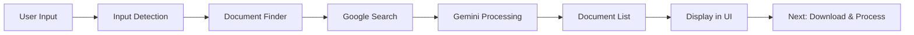

# Finance Bot Implementation Summary

## Step 1: Input Handling & UI Changes ✅

### Files Modified:
- `finance_bot/streamlit_app.py`

### Changes:
1. Added input type detection for ticker symbols vs questions
2. Created tabbed interface (Search Company / Upload Documents)
3. Added real-time input validation and type detection
4. Updated UI to show "Financial Research Assistant"
5. Added session state for tracking company, input type, and queries

### Testing:
- ✅ Ticker detection works (AAPL, MSFT, BRK.B, etc.)
- ✅ Question detection works
- ✅ Case-insensitive ticker normalization
- ✅ UI properly displays detected input types

---

## Step 2: Financial Document Discovery ✅

### Files Created:
- `utils/document_finder.py` - Document search functionality
- `utils/models.py` - Updated with document models

### Files Modified:
- `finance_bot/streamlit_app.py` - Integrated document finder

### Key Features:

#### 1. Document Finder (`utils/document_finder.py`)

**Classes:**
- `DocumentFinder`: Main class for searching financial documents
  - Uses Gemini with Google Search tool
  - Prioritizes SEC EDGAR filings (10-K, 10-Q)
  - Searches company investor relations pages
  - Filters for reputable sources

**Functions:**
- `search_documents()`: Searches for documents based on ticker/question
- `filter_by_source_type()`: Filters documents by source type
- `get_primary_documents()`: Returns prioritized documents (SEC first)
- `find_financial_documents()`: Convenience function for quick searches

#### 2. Data Models (`utils/models.py`)

**New Models:**
- `FinancialDocument`: Represents a discovered financial document
  - Fields: url, title, source_type, document_type, company_name, year
  
- `DocumentSearchResult`: Search results from Gemini
  - Fields: company_identified, documents_found, search_summary

#### 3. Streamlit Integration

**New Functions:**
- `search_and_display_documents()`: Searches and returns documents with company name

**UI Updates:**
- Search button now actually searches for documents
- Displays found documents in expandable sections
- Shows document metadata (type, source, year, URL)
- Tracks found documents in session state
- Updates company name based on search results

### How It Works:

```
User Input (ticker/question)
    ↓
Gemini constructs smart search queries
    ↓
Google Search finds documents
    ↓
Gemini extracts URLs and metadata
    ↓
Results filtered and prioritized:
    1. SEC EDGAR (10-K, 10-Q)
    2. Company Investor Relations
    3. Other reputable sources
    ↓
Documents displayed in UI
```

### Search Query Examples:

For ticker "AAPL":
- `"AAPL 10-K SEC filing site:sec.gov"`
- `"AAPL annual report PDF"`
- `"AAPL investor relations financial statements"`

For question "What is Apple's revenue?":
- Gemini extracts "Apple"
- Constructs similar queries automatically

### Key Technical Decisions:

1. **No Ticker Resolution Needed**: Google Search handles ticker symbols natively
2. **Gemini-Powered Search**: Leverages Gemini's ability to construct effective queries
3. **Structured Output**: Uses Pydantic models for type-safe results
4. **Prioritized Sources**: SEC EDGAR documents always listed first

### Testing:

To test the document finder:

```bash
cd finance_bot
streamlit run streamlit_app.py
```

Then:
1. Enter a ticker (e.g., "AAPL") or question
2. Click "Search & Analyze"
3. View found documents with metadata
4. Documents are displayed with source type, document type, and URLs

### Session State Variables:

- `found_documents`: List of FinancialDocument objects
- `document_urls`: List of document URLs for easy access
- `current_company`: Company name identified from search

---

## Next Steps

### Step 3: Document Download & Caching

Will need to:
- Create `utils/document_downloader.py`
- Download PDFs from discovered URLs
- Implement caching (hash by URL)
- Store in `docs/cache/` directory
- Return local file paths for processing

### Step 4: Enhanced Document Processing Pipeline

Will need to:
- Refactor `process_uploaded_files()` to `process_documents_from_urls()`
- Accept URLs instead of uploaded files
- Update LanceDB schema with source metadata
- Track document sources (SEC EDGAR, company IR, etc.)

---

## Architecture Overview



## Files Structure

```
finance_bot/
├── finance_bot/
│   └── streamlit_app.py          # Main UI (Steps 1 & 2 integrated)
├── utils/
│   ├── __init__.py
│   ├── models.py                  # Data models (updated)
│   ├── tools.py                   # Google Search tools
│   ├── document_finder.py         # NEW: Document search (Step 2)
│   └── get_web_page_tool.py       # Web page extraction
├── requirements.txt
└── IMPLEMENTATION_SUMMARY.md      # This file
```

---

## Environment Variables Required

Make sure `.env` file contains:
```
GEMINI_API_KEY=your_gemini_api_key_here
```

## Dependencies

From `requirements.txt`:
- google-genai (for Gemini and Google Search)
- pydantic (for data models)
- python-dotenv (for environment variables)
- streamlit (for UI)
- docling (for document processing)
- lancedb (for vector storage)

---

## Current Status

- ✅ Step 1: Input Handling & UI Changes
- ✅ Step 2: Financial Document Discovery
- ⏳ Step 3: Document Download & Caching
- ⏳ Step 4: Enhanced Document Processing Pipeline
- ⏳ Step 5: Question Answering Enhancement
- ⏳ Step 6: Report Generation
- ⏳ Step 7: Main Workflow Integration
- ⏳ Step 8: Error Handling & Edge Cases

